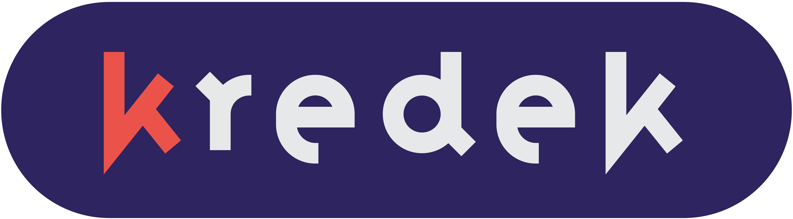

### Koło naukowe, w którym każdy ma swój kolor

Programujemy, projektujemy i uczymy się razem, od pierwszego commita do wdrożenia.

## Cześć!

Jesteśmy **KN Kredek**, kołem naukowym dla ludzi, którzy lubią tworzyć. Robimy projekty, dzielimy się wiedzą i pomagamy sobie nawzajem się rozwijać. Nieważne, czy dopiero zaczynasz, czy masz już kilka projektów na koncie. U nas znajdziesz swoje miejsce (i swój kolor 🖍️).

<!---

## Nasze projekty

| Projekt | Opis | Stack | Status |
|:--|:--|:--|:--:|
| [**strona-kredek**](https://github.com/NAZWA_ORGANIZACJI/strona-kredek) | Nowa strona internetowa koła: projekty, członkowie, wydarzenia | Vite · React · SCSS · (.NET wkrótce) | 🚧 w budowie |
| [**kredek-bot**](https://github.com/NAZWA_ORGANIZACJI/kredek-bot) | Bot na wewnętrzny serwer Discord koła: role za reakcje, weryfikacja regulaminem, komenda `/setup` | JavaScript · discord.js | 📝 planowanie |

> 💡 Jesteś w kole i masz pomysł na projekt? Otwórz issue albo podziel się nim na spotkaniu!
-->

## Z czym pracujemy

  
  
  
  
  
  
  

## Jak dołączyć?

Do koła dołącza się przez **rekrutację**. Informacje o jej terminie i zasadach publikujemy na [Facebooku](https://www.facebook.com/KNKredek/).

1. **Śledź ogłoszenia o rekrutacji** 
2. **Wypełnij formularz** rekrutacyjny 
3. **Przejdź etap rekrutacji**, czyli porozmawiaj z nami i pokaż, co Cię kręci 
4. **Po przyjęciu** dostaniesz dostęp do naszego serwera, gdzie wybierzesz kolor swojej kredki 
5. **Dołączysz do organizacji na GitHubie** i trafisz do zespołu projektowego 

## Jak współtworzyć projekty

*Dotyczy członków koła.*

- **Zadania** bierzemy z Issues. Przypisz się, zanim zaczniesz, żeby nie dublować pracy
- **Branche** nazywamy według schematu:
  - `feature/krotki-opis` dla nowych funkcji
  - `fix/krotki-opis` dla poprawek
  - `docs/krotki-opis` dla dokumentacji
- **Commity** piszemy krótko i konkretnie, np. `feat: dodaj sekcję projektów`, `fix: popraw menu na telefonie`
- **Pull Requesty**:
  - opisz, co zmieniasz i dlaczego
  - podlinkuj issue (`Closes #12`)
  - dodaj screenshot, jeśli zmieniasz coś wizualnie
  - poczekaj na review od min. 1 osoby
- **Nie pushujemy bezpośrednio na `main`**
- **Kod piszemy prosto i czytelnie**, tak żeby nowa osoba w projekcie szybko się odnalazła

## Kontakt

- 🌐 Strona: [Koło Naukowe "Kredek"](https://kredek.dce.pwr.edu.pl/)
- ✉️ E-mail: [knkredek@gmail.com](mailto:knkredek@gmail.com)
- 📱 Facebook: [facebook.com/KNKredek/](https://www.facebook.com/KNKredek/)

---

Narysowane 🖍️ przez członków **KN Kredek**

